# Análisis de la evolución de los ciberdelitos y situación de la cibercriminalidad 

Datos y estadísticas disponibles de criminalidad
https://estadisticasdecriminalidad.ses.mir.es/publico/portalestadistico/

Series anuales sobre Criminalidad 
https://estadisticasdecriminalidad.ses.mir.es/publico/portalestadistico/datos.html?type=jaxi&title=Cibercriminalidad&path=/Datos5/

## Origen de los datos 
### PORTAL ESTADÍSTICO DE CRIMINALIDAD 

    * Series anuales. Cibercriminalidad. Comunidades y Ciudades Autónomas
        * Hechos conocidos de infracciones penales relacionadas con cibercriminalidad por grupo penal
        * Hechos conocidos de infracciones penales relacionadas con cibercriminalidad por tipo hecho
        * Hechos esclarecidos de infracciones penales relacionadas con cibercriminalidad por grupo penal
        * Hechos esclarecidos de infracciones penales relacionadas con cibercriminalidad por tipo hecho
        * Detenciones e investigados de infracciones penales relacionadas con cibercriminalidad desglosado por grupo penal
        * Detenciones e investigados de infracciones penales relacionadas con cibercriminalidad desglosado por tipo hecho
        * Detenciones e investigados de infracciones penales relacionadas con cibercriminalidad desglosado por nacionalidad
        * Victimizaciones de infracciones penales relacionadas con cibercriminalidad desglosado por grupo penal
        * Victimizaciones de infracciones penales relacionadas con cibercriminalidad desglosado por tipo hecho
        * Victimizaciones de infracciones penales relacionadas con cibercriminalidad desglosado por nacionalidad 
    
    * Series anuales. Cibercriminalidad. Provincias
        * Hechos conocidos de infracciones penales relacionadas con cibercriminalidad por grupo penal
        * Hechos conocidos de infracciones penales relacionadas con cibercriminalidad por tipo hecho
        * Hechos esclarecidos de infracciones penales relacionadas con cibercriminalidad por grupo penal
        * Hechos esclarecidos de infracciones penales relacionadas con cibercriminalidad por tipo hecho
        * Detenciones e investigados de infracciones penales relacionadas con cibercriminalidad desglosado por grupo penal
        * Detenciones e investigados de infracciones penales relacionadas con cibercriminalidad desglosado por tipo hecho
        * Detenciones e investigados de infracciones penales relacionadas con cibercriminalidad desglosado por nacionalidad
        * Victimizaciones de infracciones penales relacionadas con cibercriminalidad desglosado por grupo penal
        * Victimizaciones de infracciones penales relacionadas con cibercriminalidad desglosado por tipo hecho
        * Victimizaciones de infracciones penales relacionadas con cibercriminalidad desglosado por nacionalidad 2011-2020
        * Victimizaciones de infracciones penales relacionadas con cibercriminalidad desglosado por nacionalidad 2021-2025 


### Datos locales (archivos CSV descargados del PORTAL ESTADÍSTICO DE CRIMINALIDAD)
* 05001 (Comunidades) Hechos conocidos de infracciones penales relacionadas con cibercriminalidad por grupo penal.csv
* 05002 (Provincias) Hechos conocidos de infracciones penales relacionadas con cibercriminalidad por grupo penal.csv
* 05003 (Comunidades) Hechos conocidos de infracciones penales relacionadas con cibercriminalidad por tipo hecho.csv
* 05004 (Provincias) Hechos conocidos de infracciones penales relacionadas con cibercriminalidad por tipo hecho.csv
* 05005 (Comunidades) Hechos esclarecidos de infracciones penales relacionadas con cibercriminalidad por grupo penal.csv
* 05006 (Provincias) Hechos esclarecidos de infracciones penales relacionadas con cibercriminalidad por grupo penal.csv
* 05007 (Comunidades) Hechos esclarecidos de infracciones penales relacionadas con cibercriminalidad por tipo hecho.csv
* 05008 (Provincias) Hechos esclarecidos de infracciones penales relacionadas con cibercriminalidad por tipo hecho.csv
* 05009 (Comunidades) Detenciones e investigados de infracciones penales relacionadas con cibercriminalidad desglosado por grupo penal.csv
* 05010 (Provincias) Detenciones e investigados de infracciones penales relacionadas con cibercriminalidad desglosado por grupo penal.csv
* 05011 (Comunidades) Detenciones e investigados de infracciones penales relacionadas con cibercriminalidad desglosado por tipo hecho.csv
* 05012 (Provincias) Detenciones e investigados de infracciones penales relacionadas con cibercriminalidad desglosado por tipo hecho.csv
* 05013 (Comunidades) Detenciones e investigados de infracciones penales relacionadas con cibercriminalidad desglosado por nacionalidad.csv
* 05014 (Provincias) Detenciones e investigados de infracciones penales relacionadas con cibercriminalidad desglosado por nacionalidad.csv
* 05015 (Comunidades) Victimizaciones de infracciones penales relacionadas con cibercriminalidad desglosado por grupo penal.csv
* 05016 (Provincias) Victimizaciones de infracciones penales relacionadas con cibercriminalidad desglosado por grupo penal.csv
* 05017 (Comunidades) Victimizaciones de infracciones penales relacionadas con cibercriminalidad desglosado por tipo hecho.csv
* 05018 (Provincias) Victimizaciones de infracciones penales relacionadas con cibercriminalidad desglosado por tipo hecho.csv
* 05019 (Comunidades) Victimizaciones de infracciones penales relacionadas con cibercriminalidad desglosado por nacionalidad.csv
* 05020 (Provincias) Victimizaciones de infracciones penales relacionadas con cibercriminalidad desglosado por nacionalidad 2011-2020.csv
* 05022 (Provincias) Victimizaciones de infracciones penales relacionadas con cibercriminalidad desglosado por nacionalidad 2021-2025.csv


## Estructura del repositorio:

```
https://github.com/aupatxus/cibercriminalidad/
│
├── src/
│   ├── data/          datasets.csv de origen y datasets generados 
│   │
│   ├── notebooks/     pruebas.ipynb y estudios previos
│   │
│   ├── utils/         notebooks.ipynb para generar datasets de resultados y gráficos
│   │
│   └── scripts/       scripts.py 
│   │
│   └── png/           gráficas.png generadas desde los scripts
│
└── presentación.pdf
│
└── README.md
```

## Limpieza y transformación de los datos de (origen) entrada

* `pandas`: importar, limpiar y transformar los datos.
* `numpy`: cálculos estadísticos.
* `matplotlib` y `seaborn`: visualizaciones.
* `plotly`: gráficos interactivos y mapas.


> La columna "Total" contiene datos numéricos con el formato de . para separar por miles, lo que genera un problema a la hora de importar los datos del csv ya que los interpreta como valores float en lugar de numéricos de tipo integer (int) o entero sin decimales. Para prevenir estos futuros errores procesando los datos totales se emplea el parámetro `thousands="."` para importar correctamente la columna de totales con el comando `pd.read_csv(../data/archivo.csv", sep=";", thousands=".")`


````
df = pd.read_csv("../data/archivo.csv", sep=";", thousands=".")
````


## Hipótesis en desarrollo y conclusiones previas

> NOTA: En el caso de País Vasco y Cataluña debemos tener en cuenta que el reporte de policías autonómicas (Ertzaintza y Mossos d'Esquadra) se dió a partir de 2015, frente a los datos de FCSE (Policía Nacional y Guardia Civil) que disponemos desde 2011.  


### 1. Evolución temporal de la ciberdelincuencia por tipo de delito (por grupo penal)  
> ¿Está creciendo la ciberdelincuencia?  

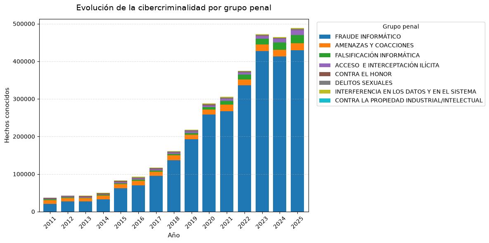

* Los ciberdelitos conocidos pasaron de 37.412 en 2011 a 488.426 en 2025 (multiplicándose por más de 13).  
     
* El Fraude Informático acumula 2.794.739 casos en todo el periodo, representando la mayoría de la ciberdelincuencia.  

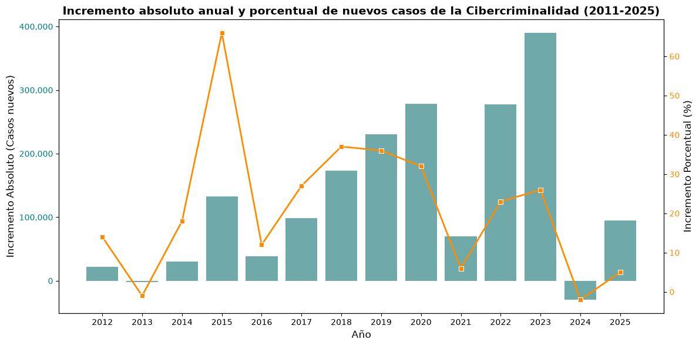

* El mayor incremento absoluto fue el año 2023 con 390.092 casos (y un 26% de incremento porcentual).  
* El mayor incremento porcentual fue el año 2015 con el 66 % (y un incremento absoluto de 132.492 casos en 2015).  

* Años con disminución de ciberdelitos:  
   * El Año 2013 bajó en 1636 casos.  
   * El Año 2024 bajó en 29836 casos.  


<hr>

### 2. Distribución por CCAA: Los lugares con mayor número de ciberdelitos (hechos conocidos)  
> ¿Dónde se producen más ciberdelitos?

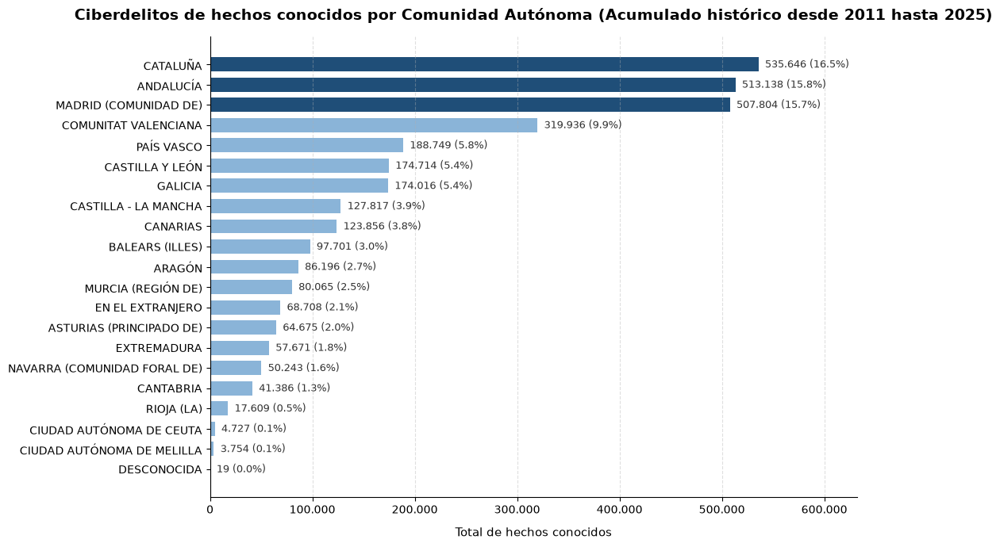  

* Tres comunidades concentran casi la mitad de todos los hechos conocidos: 19.3% Cataluña (535.646 casos), 18.5% Andalucía (513.138 casos) y 18.3% Comunidad de Madrid (507.804 casos).

<hr>

### 3. El top 10 de la tipología penal (por tipo de hecho)  
> ¿Qué ciberdelitos son los más frecuentes?


> 
> Debido a reformas legales, en el registro estadístico en 2022–2023 se realizó una reclasificación de los nombres de tipologías: 
>   
> * "ACCESO ILEGAL INFORMÁTICO" registra datos de 2011 a 2022 y a partir de 2023  pasa a 0. En 2023 aparece "ACCESO ILEGAL A SISTEMAS INFORMÁTICOS" (que estaba a 0 hasta 2022). Es el mismo delito renombrado en el sistema estadístico.  
> * "ATAQUES INFORMÁTICOS", "ATAQUES A DATOS O PROGRAMAS INFORMÁTICOS" y "ATAQUES A SISTEMAS INFORMÁTICOS" a partir de 2023 pasa a llamarse "ATAQUES A DATOS Y SISTEMAS INFORMÁTICOS". 
> * "ABUSO SEXUAL" pasa a 0 en 2023, "AGRESIÓN SEXUAL", "ABUSO SEXUAL CON PENETRACIÓN" y "AGRESIÓN SEXUAL CON PENETRACIÓN" tras la reforma del Código Penal (Ley del "solo sí es sí") se integran en "AGRESIÓN Y ABUSO SEXUAL".  
> * "ESTAFA BANCARIA" y "ESTAFAS CON TARJETAS DE CRÉDITO, DÉBITO Y CHEQUES DE VIAJE" se renombran a "ESTAFAS BANCARIAS Y CON TARJETAS/MEDIOS DE PAGO"
>

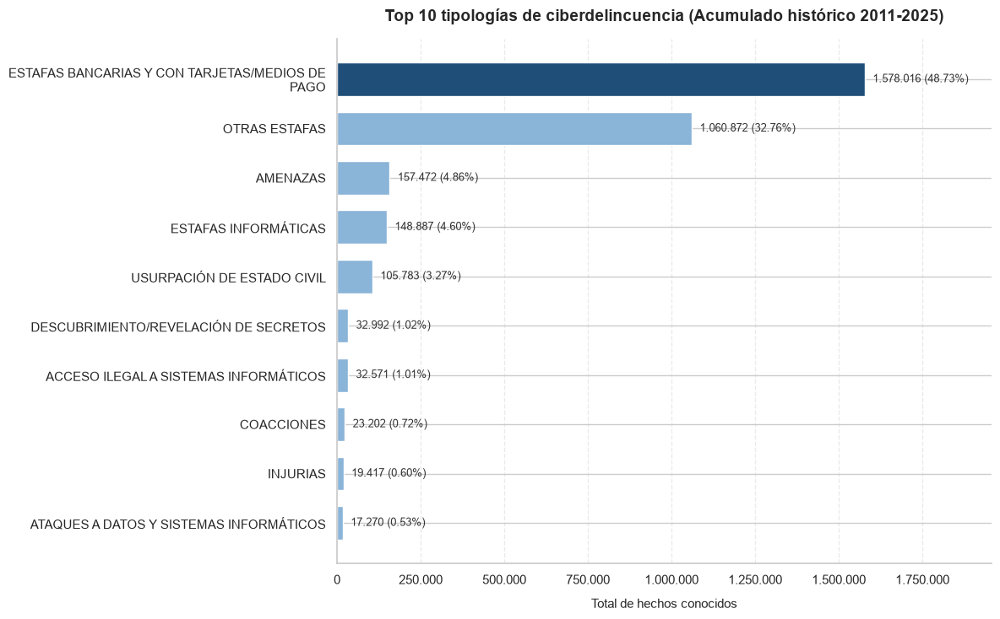

* Dentro de los fraudes, destacan las estafas bancarias y con tarjetas/medios de pago (1.578.016 casos) y otras estafas (1.060.872 casos).

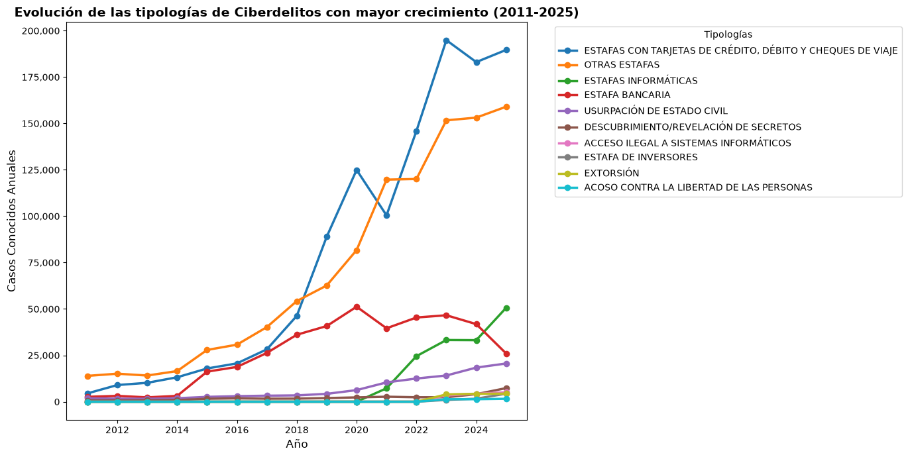  

* Del total de tipologías penales, 43 de ellas presentan una evolucion creciente.  

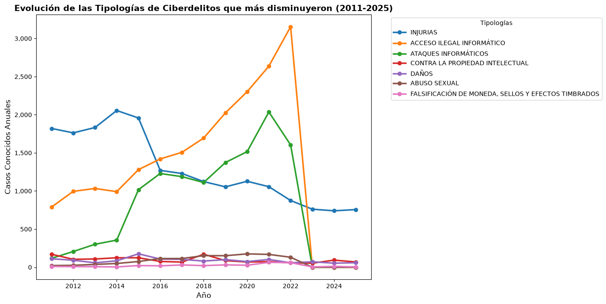  

* Del total de tipologías penales, 4 de ellas presentan una evolucion decreciente.  


<hr>

### 4. Datos conocidos vs. Datos esclarecidos: Tasa de esclarecimiento por año, por grupo penal y por CCAA de infracciones penales relacionadas con cibercriminalidad. 
> ¿Qué porcentaje de delitos se esclarece?
> 
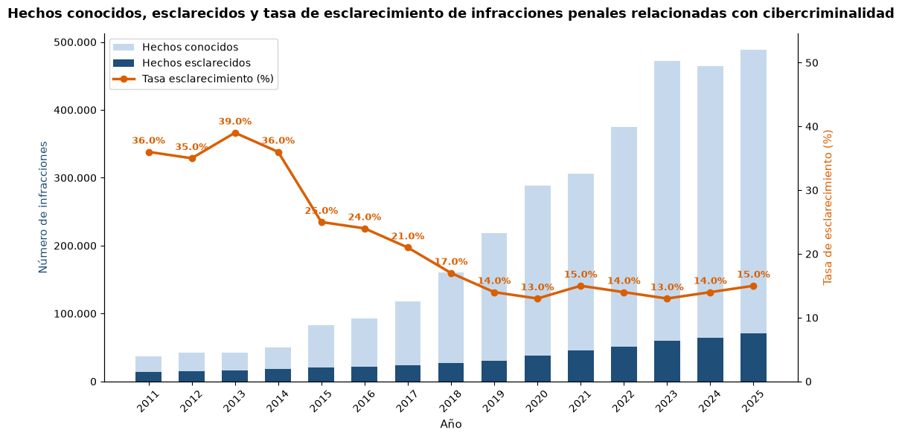  

* Mientras los casos conocidos se disparaban, la tasa nacional de esclarecimiento cayó del 36% en 2011 al 15% en 2025 (tocando suelo en el 13% en 2020 y 2023). Visualmente vemos cómo sube la barra de delitos mientras cae la línea naranja de casos resueltos.


<hr>

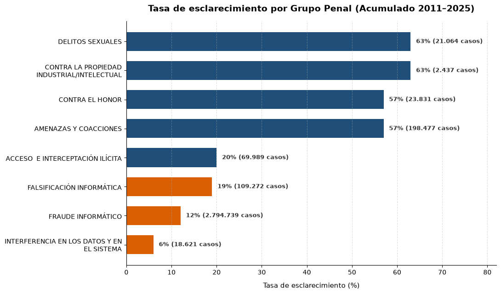  

* Por tipo de delito, los Delitos Sexuales y contra la Propiedad Industrial/Intelectual tienen un 63% de esclarecimiento, seguidos de cerca por las Amenazas y Coacciones y los delitos Contra el Honor, ambos con un 57%, mientras que el Fraude Informático apenas logra resolverse el 12% de los casos, y peor aún es el escenario en Interferencia en los datos y en el sistema (ataques informáticos, sabotajes), donde la resolución de los casos cae al 6%.  
   
* Podemos interpretar que los delitos contra las personas suelen dejar rastros directos en redes sociales o mensajería vinculados a entornos cercanos a la víctima, facilitando su investigación. En cambio, las estafas masivas y ciberataques operan mediante redes automatizadas, suplantación de identidad y servidores internacionales, lo que dificulta enormemente identificar al autor.

<hr>

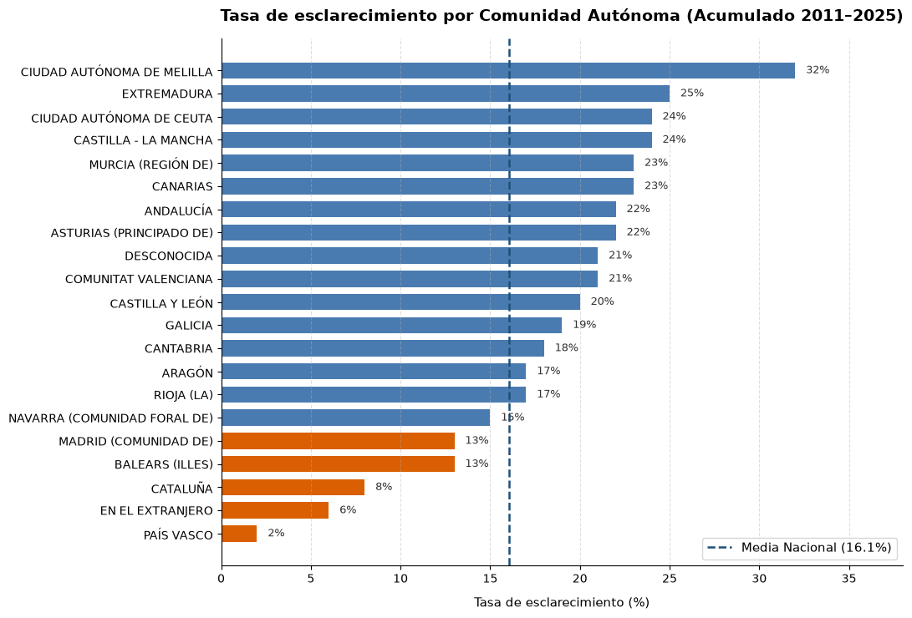  

* Hay un contraste territorial: Las regiones que concentran el mayor volumen absoluto de denuncias en España son las que presentan menores porcentajes de resolución. Mientras territorios con menor volumen como Melilla (32%), Extremadura (25%) o Castilla-La Mancha (24%) superan holgadamente la media nacional, grandes núcleos urbanos como Madrid (13%), Cataluña (8%) y País Vasco (2%) se sitúan a la cola.  
   
      
* Podemos interpretar que en comunidades con una densidad muy alta de denuncias digitales (como Madrid, con más de 500.000 hechos conocidos), el volumen masivo de estafas cotidianas satura la capacidad de investigación frente a regiones con menor carga de casos.

<hr>

### 5. Victimizaciones: ¿Qué colectivos son los más (vulnerables) atacados por la ciberdelincuencia?) Víctimas por sexo, por grupo de edad y por tipología delictiva.  
> ¿Quiénes son las víctimas? ¿Cual es el perfil de las víctimas?
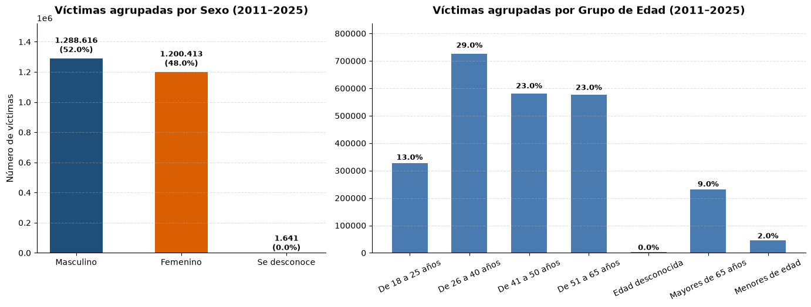

* Según el Sexo de las víctimas respecto a los datos totales acumulados de 2011 a 2025, el 52% son víctimas masculinas y 48% son víctimas femeninas.

* Según la edad de las víctimas, la mayoría se concentra en adultos jóvenes y población activa (26-40 años con el 29%, 41-50 años con el 23% y 51-65 años con el 23%), mientras que los mayores de 65 años representan el 9% y los menores el 2%.

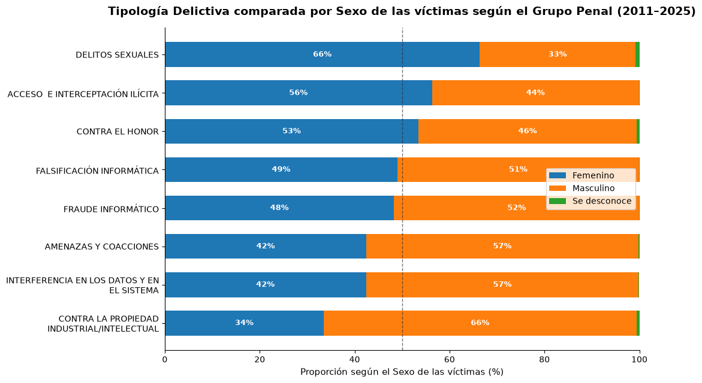

* Según la tipología de delitos, la mayoría hombres es víctima en ciberdelitos contra la propiedad industrial/intelectual con el 66% de los casos ; y la mayoría de mujeres es víctima de Delitos Sexuales con el 66% de los casos.


